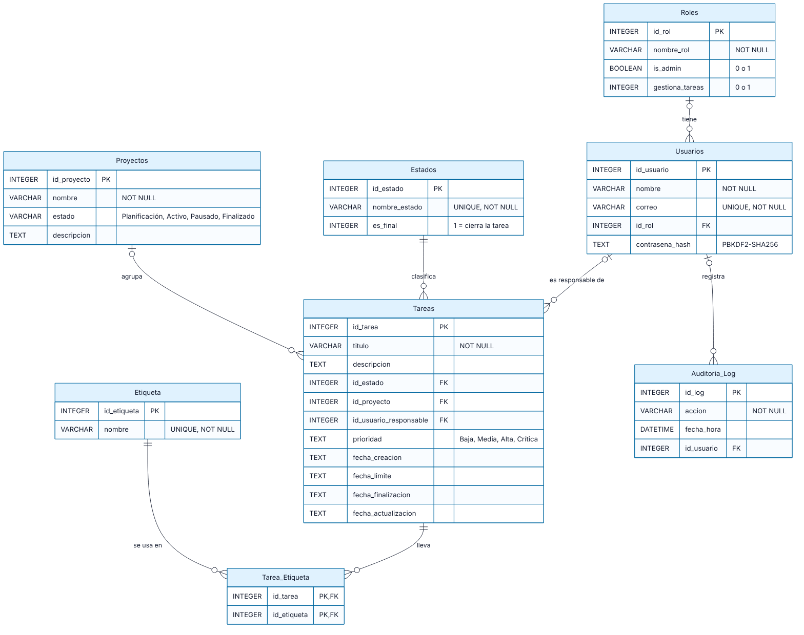

# Sistema de Gestión y Seguimiento de Tareas

Proyecto de práctica profesional en **Strategic Software Alliance S.A.S.** (ESA SAS).
Es un sistema multiplataforma para que un equipo de desarrollo organice sus tareas: quién es responsable de cada una, en qué estado está, a qué proyecto pertenece, qué prioridad tiene y cuáles están atrasadas.

El sistema tiene **una sola API y una sola base de datos**, y tres aplicaciones que las usan:

| Cliente | Tecnología | Para qué sirve |
| --- | --- | --- |
| **Web** | HTML, CSS y JavaScript | Administración completa: dashboard, tareas, proyectos y maestros |
| **Escritorio** | C# con Windows Forms (.NET 10) | Trabajo diario en Windows, con el mismo diseño de la web |
| **Móvil** | Flutter (Dart) | Consultar y actualizar tareas desde el celular |

## Arquitectura

```
 Web (navegador) ──┐
 Escritorio (.exe) ┼──► API REST ASP.NET Core (.NET 10) ──► SQLite (gestion_tareas.sqlite)
 Móvil (Flutter) ──┘        Inicio de sesión con JWT
```

- **Backend:** ASP.NET Core con ADO.NET (`Microsoft.Data.Sqlite`). Consultas SQL parametrizadas.
- **Seguridad:** inicio de sesión con token **JWT**. Las contraseñas se guardan como hash **PBKDF2-SHA256** con sal. Los permisos dependen del rol del usuario.
- **Contenedores:** la API y la web corren con **Docker Compose** (la web con Nginx).

## Funcionalidades

- Inicio de sesión con correo y contraseña. La sesión expira y se vuelve a pedir.
- **Dashboard:** total de tareas, abiertas, atrasadas y cerradas; tareas por estado, por responsable y por proyecto, y la lista de las atrasadas.
- **Tareas:** crear, editar, ver el detalle, cambiar el estado y eliminar. Filtros por estado, responsable, proyecto, prioridad y "solo atrasadas".
- **Tareas atrasadas:** una tarea está atrasada si su fecha límite ya pasó y su estado no es final.
- **Maestros editables:** Estados (con la marca "cierra la tarea"), Proyectos, Roles (con sus permisos) y Usuarios.
- **Funciona sin conexión en el móvil:** si el servidor no responde, la app muestra la última lista de tareas guardada.

### Permisos por rol

| Acción | Administrador | Líder de Proyecto | Desarrollador |
| --- | :---: | :---: | :---: |
| Ver dashboard, tareas y proyectos | ✓ | ✓ | ✓ |
| Crear y editar tareas | ✓ | ✓ | — |
| Cambiar el estado de una tarea | ✓ | ✓ | Solo las suyas |
| Eliminar tareas | ✓ | — | — |
| Maestros de Estados, Proyectos, Roles y Usuarios | ✓ | — | — |

Los permisos no están escritos en el código para cada rol. Se leen de las columnas `is_admin` y `gestiona_tareas` de la tabla `Roles`, así que un rol nuevo se configura desde la sección **Roles**.

## Estructura del repositorio

```
sistema-gestion-tareas/
├── Backend/              API ASP.NET Core (Controllers, Seguridad, Program.cs, Dockerfile)
│   └── Backend.http      Pruebas de la API (44 casos)
├── src/                  Dashboard web (index.html, styles.css, script.js)
├── escritorio/           Aplicación de escritorio Windows Forms
├── movil/                Aplicación móvil Flutter (lib/ y test/)
├── nginx/                Configuración de Nginx para Docker
├── datos/                Base de datos que usa Docker (no se sube a Git)
├── docs/                 Bitácoras, requerimientos, diagrama, scripts SQL y pruebas
├── docker-compose.yml
└── .env.ejemplo          Variables de entorno de ejemplo para Docker
```

## Cómo ejecutar el proyecto

### Opción 1: con Docker (recomendada)

Requisitos: [Docker Desktop](https://www.docker.com/products/docker-desktop/).

```powershell
copy .env.ejemplo .env          # luego cambiar JWT_CLAVE por una clave larga y aleatoria
copy Backend\gestion_tareas.sqlite datos\gestion_tareas.sqlite
docker compose up -d --build
```

- Web: http://localhost:8080
- API: http://localhost:5293/api

Para detenerlo: `docker compose down`. Los datos quedan guardados en la carpeta `datos/`.

### Opción 2: en modo desarrollo

1. **API:** abrir `Backend/Backend.slnx` en Visual Studio y ejecutar con el perfil `https`, o desde la terminal:
   ```powershell
   cd Backend
   dotnet run --launch-profile https
   ```
   Queda en `https://localhost:7019` y `http://localhost:5293`.
2. **Web:** abrir `src/index.html` con la extensión Live Server de VS Code (puerto 5500).
3. **Escritorio:**
   ```powershell
   cd escritorio
   dotnet run
   ```
   Usa `http://localhost:5293/api/`. Para cambiarla, se define la variable de entorno `GESTION_TAREAS_API`.
4. **Móvil:** con un emulador de Android abierto,
   ```powershell
   cd movil
   flutter pub get
   flutter run
   ```
   Desde el emulador, la API se encuentra en `http://10.0.2.2:5293/api`.

### Pruebas

```powershell
cd movil
flutter analyze
flutter test        # 7 pruebas de widgets
```

Las pruebas de la API están en `Backend/Backend.http` y se ejecutan desde Visual Studio.

## Base de datos

Motor **SQLite**. El esquema completo está en [`docs/esquema_base_datos.sql`](docs/esquema_base_datos.sql). Para actualizar una base antigua están las migraciones `migracion_v2_tareas.sql`, `migracion_v3_proyectos.sql` y `migracion_v4_login_permisos.sql`.



## Documentación

- [Requerimientos y casos de uso](docs/requerimientos.md)
- [Matriz de pruebas funcionales y de API](docs/Matriz-Pruebas-Funcionales-y-API.md)
- Bitácoras semanales: `docs/bitacora-semana1.md` a `docs/bitacora-semana13.md`

## Tecnologías y herramientas

ASP.NET Core (.NET 10), C#, SQLite, JWT, HTML5, CSS3, JavaScript, Windows Forms, Flutter y Dart, Docker, Nginx, Git y GitHub, Visual Studio, Visual Studio Code, Android Studio y PowerShell.

## Autora

**Fernanda Marín Tobón**, practicante de Ingeniería de Sistemas (Corporación Universitaria Minuto de Dios).
Tutor: Luis Abreu Acevedo, Strategic Software Alliance S.A.S.
