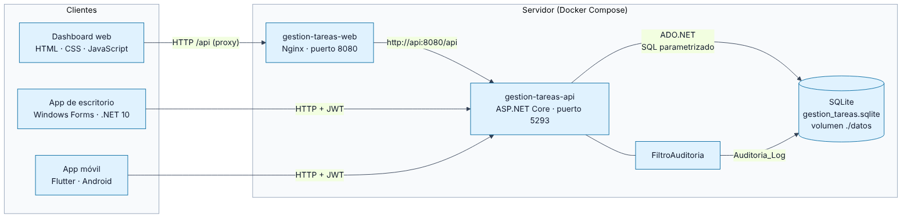

# Manual Técnico y Documentación de Despliegue

**Proyecto:** Sistema de Gestión y Seguimiento de Tareas
**Empresa:** Strategic Software Alliance S.A.S. (ESA SAS)
**Autora:** Fernanda Marín Tobón
**Versión del sistema:** 5 (con auditoría), noviembre de 2026
**Repositorio:** https://github.com/fernandamarin12345g-spec/sistema-gestion-tareas

Este manual explica cómo está construido el sistema, cómo se configura un equipo para trabajar en él, qué buenas prácticas se aplicaron y cómo se despliega, paso a paso, en un servidor Linux. Está dirigido a quien tenga que mantener, ejecutar o desplegar el sistema.

---

## 1. Arquitectura de integración



El sistema sigue una arquitectura **cliente-servidor** con una **API REST** como único punto de acceso a los datos.

| Componente | Tecnología | Se ejecuta en | Puerto |
| --- | --- | --- | --- |
| API REST | ASP.NET Core (.NET 10), C# | Contenedor `gestion-tareas-api` | 8080 dentro del contenedor y **5293** en el servidor |
| Base de datos | SQLite (`gestion_tareas.sqlite`) | Archivo en el volumen `./datos` | — |
| Servidor web | Nginx 1.27 (Alpine) | Contenedor `gestion-tareas-web` | 80 dentro del contenedor y **8080** en el servidor |
| Dashboard web | HTML, CSS y JavaScript (SPA) | Navegador del usuario | — |
| App de escritorio | Windows Forms (.NET 10) | PC con Windows | — |
| App móvil | Flutter (Dart) | Celular o emulador Android | — |

**Cómo se comunican:**
- La **web** pide sus datos a `/api/...` en el mismo servidor, y **Nginx** reenvía esas peticiones al contenedor de la API por la red interna de Docker (`http://api:8080/api/`). Así la web y la API comparten dirección y no hay problemas de CORS.
- El **escritorio** y el **móvil** llaman directamente a la API en el puerto 5293.
- Todas las peticiones, menos el inicio de sesión, llevan el encabezado `Authorization: Bearer <token JWT>`.
- La API es la única que lee y escribe la base de datos (con ADO.NET y SQL parametrizado), así que las reglas de negocio y los permisos valen igual para los tres clientes.
- El `FiltroAuditoria` registra en `Auditoria_Log` cada cambio que la API acepta.

## 2. Tecnologías y versiones

| Área | Herramienta | Versión |
| --- | --- | --- |
| Backend | .NET SDK / ASP.NET Core | 10.0 |
| Paquetes NuGet | Microsoft.Data.Sqlite / JwtBearer / OpenApi | 10.0.12 / 10.0.14 / 10.0.12 |
| Escritorio | Windows Forms | .NET 10 (`net10.0-windows`) |
| Móvil | Flutter / Dart SDK | Dart ^3.13.5; paquetes `http` ^1.6.0 y `shared_preferences` ^2.5.6 |
| Contenedores | Docker Desktop (Windows) / Docker Engine y Compose v2 (Linux) | — |
| Servidor web | Nginx | 1.27-alpine |
| Servidor de despliegue | Ubuntu Server en VirtualBox | 26.04.1 LTS |
| Control de versiones | Git y GitHub | — |
| Editores | Visual Studio 2026, Visual Studio Code, Android Studio | — |

## 3. Estructura del repositorio

```
sistema-gestion-tareas/
├── Backend/
│   ├── Controllers/        Auth, Tareas, Proyectos, Estados, Roles, Usuarios, Auditoria
│   ├── Seguridad/          Políticas, tokens JWT y hash de contraseñas
│   ├── Auditoria/          FiltroAuditoria y ServicioAuditoria
│   ├── Program.cs          Configuración: servicios, JWT, políticas, CORS, filtro
│   ├── appsettings.json    Configuración sin secretos
│   ├── Backend.http        48 pruebas de la API
│   ├── Dockerfile          Imagen de la API (dos etapas)
│   └── .dockerignore
├── src/                    Dashboard web (index.html, styles.css, script.js)
├── escritorio/             App de escritorio Windows Forms
├── movil/                  App Flutter (lib/ y test/)
├── nginx/default.conf      Nginx: sirve la web y hace de proxy de /api
├── datos/                  Base de datos de Docker (fuera de Git)
├── docs/                   Bitácoras, requerimientos, diagramas, SQL, pruebas y este manual
├── docker-compose.yml
├── .env.ejemplo            Variables de entorno de ejemplo (la clave real va en .env, fuera de Git)
└── README.md
```

## 4. Configuración del entorno de desarrollo

### 4.1 Requisitos (Windows)

1. **Git** y una cuenta de GitHub.
2. **Visual Studio 2026** con la carga de trabajo *Desarrollo de ASP.NET y web*, o el **.NET 10 SDK**.
3. **Visual Studio Code** con las extensiones Live Server, SQLite, GitLens y Prettier.
4. **Flutter SDK** y **Android Studio**, con un emulador (*Medium Phone API 37*). En Windows también hay que activar el **Modo de desarrollador** para que Flutter pueda usar plugins.
5. **Docker Desktop**, con WSL 2.

### 4.2 Obtener el código

```powershell
git clone https://github.com/fernandamarin12345g-spec/sistema-gestion-tareas.git
cd sistema-gestion-tareas
```

### 4.3 Ejecutar en modo desarrollo

| Parte | Comando o acción | Dirección |
| --- | --- | --- |
| API | `cd Backend` y `dotnet run --launch-profile https` (o F5 en Visual Studio) | `https://localhost:7019` y `http://localhost:5293` |
| Web | Abrir `src/index.html` con Live Server | `http://127.0.0.1:5500` (usa la API de `https://localhost:7019/api`) |
| Escritorio | `cd escritorio` y `dotnet run` | Usa `http://localhost:5293/api/` |
| Móvil | `cd movil`, `flutter pub get` y `flutter run` con el emulador abierto | Usa `http://10.0.2.2:5293/api`, que es el PC visto desde el emulador |

## 5. Configuración

### 5.1 Archivos y variables

| Parámetro | Dónde se define | Para qué sirve |
| --- | --- | --- |
| `ConnectionStrings:DefaultConnection` | `appsettings.json`; en Docker, la variable `ConnectionStrings__DefaultConnection` | Ruta del archivo SQLite |
| `Jwt:Emisor`, `Jwt:Audiencia`, `Jwt:MinutosExpiracion` | `appsettings.json` | Datos del token. La sesión dura 480 minutos |
| `Jwt:Clave` | En desarrollo, `appsettings.Development.json`; en Docker, la variable `Jwt__Clave` que se toma de `.env` | Clave secreta con la que se firman los tokens. **Nunca va en Git** |
| `ASPNETCORE_ENVIRONMENT` | `launchSettings.json` (Development) o Docker (Production) | En producción se activa la redirección a HTTPS y se desactiva OpenAPI |
| `TZ` | `docker-compose.yml` | Hora de Colombia (`America/Bogota`) en las fechas que guarda la API |
| `GESTION_TAREAS_API` | Variable de entorno del PC | Cambia la dirección de la API que usa la app de escritorio |
| `apiBaseUrl` | `movil/lib/config/api_config.dart` | Dirección de la API que usa la app móvil |
| `API_BASE_URL` | `src/script.js` | Con Live Server (puerto 5500) usa la API de Visual Studio; en Docker o en el servidor usa `/api` |

> En ASP.NET Core, el doble guion bajo `__` de una variable de entorno equivale a `:` en `appsettings.json`. Por ejemplo, `Jwt__Clave` es `Jwt:Clave`.

### 5.2 Base de datos

- El esquema completo (versión 5) está en `docs/esquema_base_datos.sql` y el diagrama en `docs/diagrama-entidad-relacion-v4.png`.
- Para actualizar una base antigua están las migraciones v2 a v5 de `docs/`. La v5 (auditoría) la aplica la API sola al arrancar.
- **Respaldo:** antes de cualquier cambio en la estructura, copiar el archivo `.sqlite` (por ejemplo `gestion_tareas.backup-v4.sqlite`).

## 6. Seguridad

| Aspecto | Cómo se resolvió |
| --- | --- |
| Autenticación | `POST /api/Auth/login` devuelve un **token JWT** firmado con HMAC-SHA256, que vence a las 8 horas |
| Contraseñas | Se guardan como hash **PBKDF2-SHA256** con sal y 100.000 iteraciones (`ServicioContrasenas.cs`) |
| Autorización | Por defecto todas las rutas exigen sesión (`FallbackPolicy`). Políticas `Administrador` y `GestionTareas`, leídas de las columnas `is_admin` y `gestiona_tareas` del rol |
| Inyección SQL | Todas las consultas usan parámetros (`@nombre`) |
| Validación | Toda la validación se hace en la API, aunque los clientes también validen |
| Secretos | La clave JWT vive en `.env` o en `appsettings.Development.json`, que están en `.gitignore` |
| Auditoría | Cada cambio y cada inicio de sesión (también los fallidos) queda registrado en `Auditoria_Log` |

## 7. Referencia de la API

Base: `http://<servidor>:5293/api`. Todas las rutas, menos el login, exigen `Authorization: Bearer <token>`.

| Método | Ruta | Permiso | Descripción |
| --- | --- | --- | --- |
| POST | `/Auth/login` | Libre | Inicia sesión y devuelve el token |
| GET | `/Auth/yo` | Sesión | Datos del usuario de la sesión |
| GET | `/Tareas` | Sesión | Lista. Filtros: `id_estado`, `id_usuario`, `id_proyecto`, `prioridad`, `atrasadas=true` |
| GET | `/Tareas/{id}` | Sesión | Detalle de una tarea |
| POST | `/Tareas` | GestionTareas | Crea una tarea |
| PUT | `/Tareas/{id}` | GestionTareas | Edita una tarea |
| PATCH | `/Tareas/{id}/estado` | Sesión (el Desarrollador, solo en sus tareas) | Cambia solo el estado |
| DELETE | `/Tareas/{id}` | Administrador | Elimina una tarea |
| GET / POST / PUT / DELETE | `/Proyectos` | GET con sesión; el resto, Administrador | Maestro de proyectos (no deja eliminar uno con tareas) |
| GET / POST / PUT / DELETE | `/Estados` | GET con sesión; el resto, Administrador | Maestro de estados (`es_final` = cierra la tarea) |
| GET / POST / PUT / DELETE | `/Roles` | GET con sesión; el resto, Administrador | Maestro de roles y permisos |
| GET / POST / PUT / DELETE | `/Usuarios` | GET con sesión; el resto, Administrador | Usuarios con su rol y sus tareas |
| GET | `/Auditoria?limite=200&modulo=Tareas` | Administrador | Registro de auditoría, del más reciente al más antiguo |

**Códigos de respuesta:** `200` correcto, `201` creado, `400` dato inválido (con `{"mensaje": "..."}`), `401` sin sesión o sesión vencida, `403` sin permiso, `404` no existe.

## 8. Buenas prácticas aplicadas

**Control de versiones**
- Una rama por funcionalidad (`feature-docker`, `feature-movil-menu`, `feature-auditoria`...). Se une a `main` solo cuando está probada.
- Commits con mensajes que dicen qué cambió.
- `.gitignore` en la raíz: no se suben `bin/`, `obj/`, `.vs/`, bases `.sqlite` ni `.env`.

**Código**
- Separación por capas: controladores (HTTP), seguridad, auditoría y acceso a datos en la API; modelos, servicios y pantallas en el móvil.
- Validación en el servidor, con mensajes de error claros en español.
- SQL parametrizado y bloques `using` para cerrar conexiones y comandos.
- El texto que se muestra en la web pasa por `escaparHTML()` para evitar XSS.
- Comentarios en español que explican el porqué de cada decisión.
- Un mismo diseño (colores y menú) para los tres clientes.

**Calidad**
- 48 pruebas de API en `Backend.http`, 7 pruebas automáticas en Flutter y una matriz de 63 casos con evidencias.
- Registro de errores con causa, corrección y validación (`Reporte-Calidad-Registro-Errores.md`).
- `dotnet build` y `flutter analyze` sin errores antes de cada commit.

**Configuración y despliegue**
- Los secretos se pasan por variables de entorno, no en el código.
- La imagen Docker se construye en dos etapas: compila con el SDK y ejecuta con el runtime, más liviano.
- Los datos van en un volumen, fuera del contenedor.
- Se hace una copia de la base antes de cada migración.

## 9. Despliegue local con Docker (Windows)

```powershell
copy .env.ejemplo .env            # y cambiar JWT_CLAVE por una clave larga y aleatoria
copy Backend\gestion_tareas.sqlite datos\gestion_tareas.sqlite
docker compose up -d --build      # construir y levantar
docker compose ps                 # ver el estado
docker compose logs api --tail 30 # ver los logs de la API
docker compose down               # detener
```

Web: `http://localhost:8080`. API: `http://localhost:5293/api`.

## 10. Despliegue en un servidor Linux (paso a paso)

**Entorno de prueba:** una máquina virtual con **Ubuntu Server 26.04.1 LTS** en VirtualBox, con 2 CPU, 4 GB de RAM y 25 GB de disco. La red está en **modo puente**, así que la máquina tiene su propia IP en la red local (`192.168.1.6`), como si fuera un servidor más de la red. El mismo procedimiento sirve para un VPS en la nube, cambiando la IP.

### 10.1 Preparar el servidor

1. Instalar Ubuntu Server con **OpenSSH server** activado y el usuario `fer`.
2. Ver la IP del servidor: `ip a` (interfaz `enp0s3`).
3. Desde Windows, entrar por SSH:
   ```powershell
   ssh fer@192.168.1.6
   ```
4. Actualizar el sistema e instalar Docker:
   ```bash
   sudo apt update && sudo apt upgrade -y
   sudo apt install -y docker.io docker-compose-v2 unzip
   sudo usermod -aG docker fer     # usar docker sin sudo (hay que salir y volver a entrar)
   docker --version && docker compose version
   ```

### 10.2 Copiar el proyecto (SFTP/SCP)

Desde Windows, en la carpeta del proyecto:

```powershell
git archive -o proyecto.zip HEAD                                    # solo los archivos de Git, sin bin/obj
scp proyecto.zip fer@192.168.1.6:~/                                 # copia el código
scp datos\gestion_tareas.sqlite fer@192.168.1.6:~/gestion_tareas.sqlite   # copia la base de datos
```

### 10.3 Configurar y levantar

En el servidor:

```bash
mkdir -p ~/sistema-gestion-tareas && cd ~/sistema-gestion-tareas
unzip -o ~/proyecto.zip
mkdir -p datos && mv ~/gestion_tareas.sqlite datos/
echo "JWT_CLAVE=$(openssl rand -base64 48)" > .env      # clave nueva y distinta a la de desarrollo
chmod 600 .env                                           # solo el dueño puede leerla
docker compose up -d --build
docker compose ps
```

### 10.4 Verificar

| Prueba | Dónde | Resultado esperado |
| --- | --- | --- |
| Web | Navegador del PC: `http://192.168.1.6:8080` | Pantalla de inicio de sesión y, después, el dashboard |
| Web desde el celular | Navegador del celular conectado al mismo Wi-Fi | El mismo dashboard |
| API | `curl http://192.168.1.6:5293/api/Tareas` | `401` (pide sesión): la API responde |
| Escritorio | En PowerShell, `$env:GESTION_TAREAS_API="http://192.168.1.6:5293/api/"` y luego `dotnet run` en `escritorio` | La app se conecta al servidor |
| Logs | `docker compose logs api --tail 30` | `Now listening on: http://[::]:8080` |

### 10.5 Operación y mantenimiento

| Tarea | Comando |
| --- | --- |
| Ver contenedores | `docker compose ps` |
| Ver logs en vivo | `docker compose logs -f api` (Ctrl+C para salir) |
| Reiniciar | `docker compose restart` |
| Actualizar a una versión nueva | Copiar el `.zip` nuevo, `unzip -o` y `docker compose up -d --build` |
| Respaldar la base | `cp datos/gestion_tareas.sqlite ~/respaldo-$(date +%F).sqlite` |
| Espacio en disco | `df -h` |
| Uso de memoria | `free -h` |
| Apagar el servidor | `sudo shutdown now` |

Los contenedores tienen `restart: unless-stopped`, así que vuelven a arrancar solos cuando el servidor se reinicia.

### 10.6 Para un entorno de producción real

- **Dominio y DNS:** registrar un dominio (por ejemplo `tareas.empresa.com`) con un registro DNS tipo **A** que apunte a la IP pública del VPS.
- **HTTPS:** poner un certificado gratuito de Let's Encrypt en Nginx (con Certbot) y dejar solo los puertos 80 y 443 abiertos.
- **Firewall:** `sudo ufw allow OpenSSH`, `sudo ufw allow 80,443/tcp` y `sudo ufw enable`. El puerto 5293 no debería quedar abierto a Internet.
- **SSH con llave** en lugar de contraseña (`ssh-keygen` y `ssh-copy-id`).
- **Respaldos automáticos** de la base con `cron`.

## 11. Solución de problemas

| Síntoma | Causa probable | Solución |
| --- | --- | --- |
| La web dice "No se pudo conectar con el servidor" | La API está detenida o el navegador tiene una versión vieja del JS | `docker compose ps`, y recargar con Ctrl+Shift+R |
| `401` en todas las pantallas | El token venció o la clave JWT cambió | Cerrar sesión y volver a entrar |
| La web se ve sin estilos nuevos | Caché del navegador | Ctrl+Shift+R; `index.html` usa `?v=` para obligar a descargar la versión nueva |
| Las fechas salen 5 horas adelantadas | El contenedor está en hora UTC | Revisar `TZ=America/Bogota` en `docker-compose.yml` |
| `no such table` | La base de datos no está en `datos/` | Copiar `gestion_tareas.sqlite` a `datos/` y reiniciar |
| No hay conexión SSH | Servidor apagado, IP cambiada o SSH sin instalar | `ip a` en el servidor y `sudo systemctl status ssh` |
| El emulador no ve la API | Se usó `localhost` en vez de `10.0.2.2` | Revisar `api_config.dart` |
