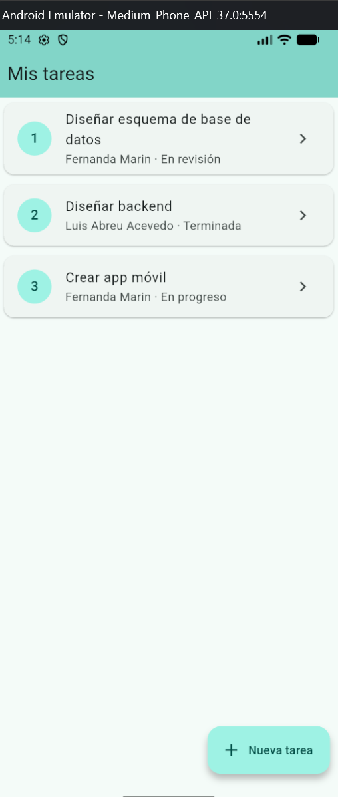
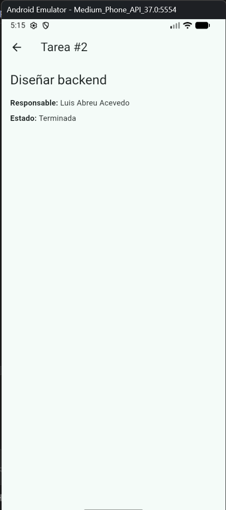
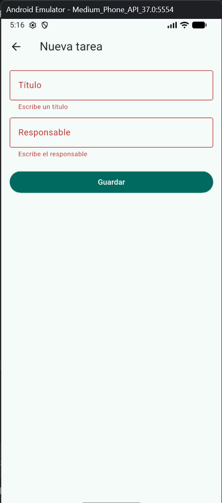
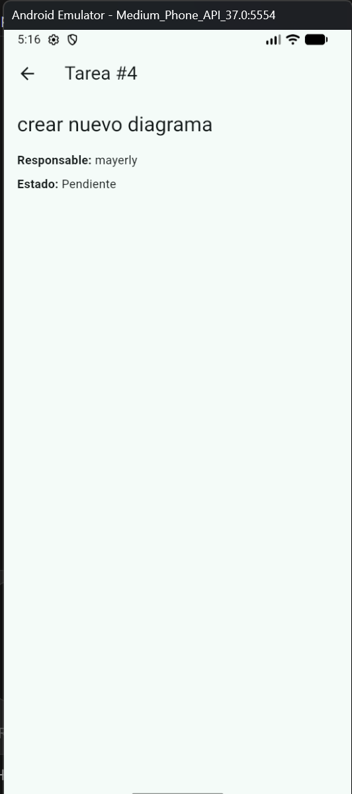

# Bitácora Semana 10

**Tema:** Introducción al desarrollo móvil
**Entregable:** Aplicación móvil inicial con navegación y estructura básica (Flutter)

## ¿Qué aprendí?

- **Estructura de un proyecto Flutter:** el código de la app vive en `lib/`, y las carpetas `android`, `ios`, `web`, `windows`, `linux` y `macos` son las que Flutter usa para generar la app en cada plataforma a partir del mismo código.
- **Organización por capas:** separé la app en `models/` (qué es una tarea), `services/` (de dónde salen los datos) y `screens/` (lo que ve el usuario). Así, en la semana 11 solo cambia el servicio para consumir la API, sin tocar las pantallas.
- **Navegación entre pantallas:** `Navigator.push` abre una pantalla nueva encima de la actual (como una pila) y `Navigator.pop` la cierra y vuelve a la anterior; también puede devolver datos, como hace el formulario al crear una tarea.
- **StatelessWidget vs. StatefulWidget:** la pantalla de detalle es `StatelessWidget` porque solo muestra los datos de la tarea que recibe y no cambia mientras está abierta. La lista es `StatefulWidget` porque su contenido cambia cuando se agrega una tarea nueva; con `setState` le aviso a Flutter que los datos cambiaron y que vuelva a dibujar la pantalla.
- **Formularios y validación:** `Form` + `TextFormField` con `validator` muestran mensajes de error sin enviar datos vacíos.
- **Emulador de Android:** cómo encenderlo desde VS Code y ejecutar la app con `flutter run`.
- **Pruebas automatizadas:** `flutter test` ejecuta una prueba que verifica que la app abre en la lista de tareas.

## Diferencias entre web y móvil

| Aspecto | Web (dashboard) | Móvil (Flutter) |
| --- | --- | --- |
| Dónde se ejecuta | En el navegador | Instalada en el teléfono o emulador |
| Lenguaje | HTML + CSS + JavaScript | Dart |
| Interfaz | Elementos HTML con estilos CSS | Widgets |
| Navegación | `#hash` en la URL | `Navigator.push` / `Navigator.pop` (pila de pantallas) |
| Actualizar la vista | Modificar el DOM con `innerHTML` | `setState` y Flutter redibuja |
| Distribución | Se publica en un servidor | Se instala (APK / tiendas de aplicaciones) |

## ¿Qué problemas encontré?

- **Archivos de compilación en el repositorio:** el repositorio tenía 127 archivos, la mayoría generados por Visual Studio (`bin/`, `obj/`, `.vs/`) y la base de datos `gestion_tareas.sqlite`, porque no existía un `.gitignore` en la raíz.
- **Confusión entre dos `.gitignore`:** al crear el archivo encontré uno dentro de `movil/` (el que trae Flutter) y no el de la raíz del proyecto.
- **Prueba rota:** `widget_test.dart` seguía buscando la clase `MyApp` del proyecto de ejemplo de Flutter, que ya no existía, y marcaba un error.

## ¿Cómo los resolví?

- Creé un `.gitignore` en la raíz y quité esos archivos solo de Git con `git rm -r --cached`, sin borrarlos de mi computador.
- Verifiqué la ruta del archivo en VS Code (`movil > .gitignore` frente a `.gitignore` en la raíz) y creé el correcto con `code .gitignore` desde la terminal.
- Reescribí la prueba para que use `AppGestionTareas` y verifique que aparece el título "Mis tareas"; `flutter test` pasó.
- Trabajé en una rama nueva (`feature-movil-semana10`) en lugar de hacerlo directo en `main`.

## Evidencias

| Pantalla | Captura |
| --- | --- |
| Lista de tareas |  |
| Detalle de tarea |  |
| Validación del formulario |  |
| Tarea nueva creada |  |

Resultados: `flutter analyze` → *No issues found* · `flutter test` → *All tests passed*

## ¿Qué conceptos aún no domino?

Todavía me falta práctica con el manejo de estado cuando la app crezca, más allá de `setState`, y con la programación asíncrona en Dart (`async`/`await` y `Future`), que voy a necesitar para pedirle los datos a la API. También debo entender mejor cómo se conecta el emulador al backend que corre en mi computador, que es el reto de la próxima semana.
