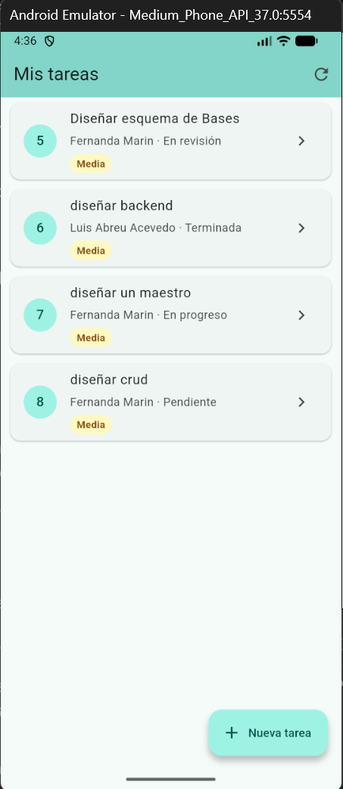
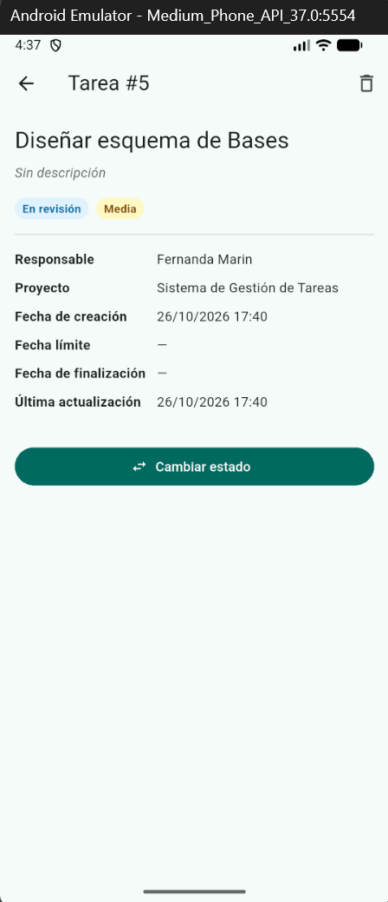
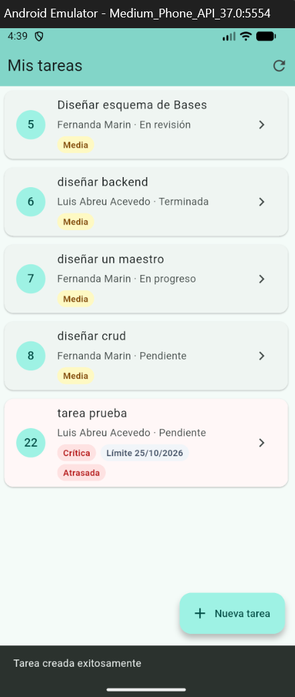
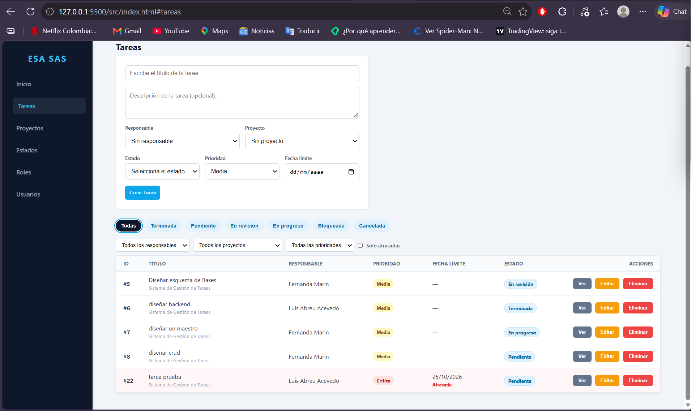
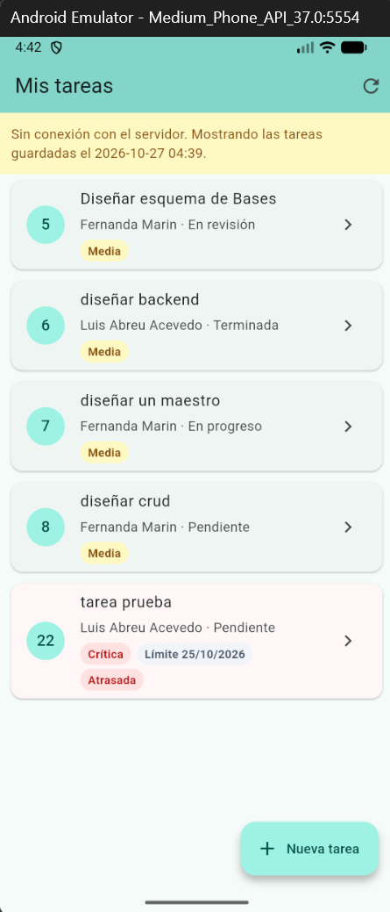

# Bitácora Semana 11

**Tema:** Móvil conectado al backend
**Entregable:** Cliente móvil del sistema de tareas consumiendo la misma API que el dashboard web

## ¿Qué aprendí?

- **Consumo de una API desde Flutter:** con el paquete `http` la app hace `GET`, `POST`, `PUT` y `DELETE` a la misma API de ASP.NET Core que usa la web. Web y móvil son dos clientes distintos que comparten el mismo backend y la misma base de datos: una tarea creada desde el teléfono aparece de inmediato en el dashboard web.
- **JSON a objetos:** el método `Tarea.fromJson` convierte el JSON que devuelve la API en objetos de Dart, usando los mismos nombres de campo del backend (`usuario_asignado`, `fecha_limite`, `atrasada`...).
- **Programación asíncrona en Dart:** las peticiones a la API devuelven un `Future`, y con `async`/`await` la app espera la respuesta sin congelar la pantalla.
- **Estados de una pantalla:** cada pantalla maneja tres situaciones: cargando (indicador circular), error (mensaje y botón *Reintentar*) y datos (la lista). Con `setState` la pantalla se vuelve a dibujar cuando cambia el estado.
- **Manejo de errores:** si el backend está apagado se muestra un mensaje claro, y si la API rechaza un dato (por ejemplo, un título vacío) la app muestra el mensaje que devuelve la API (`{ "mensaje": "..." }`).
- **Persistencia local básica:** con `shared_preferences` la app guarda en el teléfono la última lista de tareas que descargó. Sin conexión, muestra esa copia con un aviso amarillo.
- **Red del emulador:** dentro del emulador, `localhost` es el propio emulador; para llegar al backend del computador se usa `10.0.2.2`. Además, Android bloquea HTTP sin cifrar por defecto, así que se permitió solo en modo debug (`usesCleartextTraffic`), y el backend dejó de redirigir a HTTPS en desarrollo.
- **Pruebas con un servicio falso:** las pruebas de `flutter test` usan un servicio que devuelve datos fijos, así se prueba la pantalla sin depender de la red.

## Mejoras del backend y la web (base para el cliente móvil)

- **Validaciones en la API:** títulos y nombres vacíos, correos inválidos, roles y proyectos repetidos, prioridades y fechas mal escritas se rechazan con `400 Bad Request` y un mensaje claro.
- **Códigos de estado REST:** crear responde `201 Created` con el id nuevo; consultar, editar o eliminar un registro que no existe responde `404 Not Found`.
- **Tareas versión 2:** descripción, prioridad (Baja, Media, Alta, Crítica), proyecto, fecha de creación, fecha límite, fecha de finalización y fecha de última actualización. Se agregaron con un script de migración que no borra datos (`docs/migracion_v2_tareas.sql`).
- **Regla de tarea atrasada:** una tarea está atrasada si su fecha límite ya pasó y su estado no es final. Para que no dependa del nombre del estado, se agregó la columna `es_final` a `Estados` (Terminada y Cancelada).
- **Maestro de Proyectos:** sección propia para crear, editar y eliminar proyectos, con descripción, estado (Planificación, Activo, Pausado, Finalizado) y conteo de tareas. No se permite eliminar un proyecto que todavía tiene tareas.
- **Dashboard de inicio:** total de tareas, abiertas, atrasadas y cerradas, y distribución por estado, por responsable y por proyecto.
- **Seguridad en la web:** el texto se escapa antes de mostrarse (evita XSS), y un título con apóstrofe ya no rompe el botón *Editar*.

## ¿Qué problemas encontré?

- **El emulador no respondía:** `flutter run` compilaba la app pero se quedaba en `Installing...` con el error `adb shell am force-stop failed: Process timed out`.
- **Windows bloqueaba los plugins:** al instalar `shared_preferences` apareció *"Building with plugins requires symlink support"*.
- **La base de datos quedó vacía:** al unir una rama a `main` con Git, como la base de datos todavía estaba guardada en `main`, Git la borró del disco y el backend respondía `no such table: Tareas`.
- **HTTPS en el emulador:** el backend redirigía las peticiones HTTP a HTTPS, y el emulador no confía en el certificado de desarrollo.
- **Nombres repetidos con tildes:** la función `LOWER()` de SQLite no convierte letras con tilde, así que "GESTIÓN" y "gestión" no se detectaban como iguales.

## ¿Cómo los resolví?

- Reinicié el conector del emulador (`adb kill-server` y `adb start-server`) y encendí el emulador en frío (`flutter emulators --launch ... --cold`).
- Activé el **Modo de desarrollador** de Windows y volví a ejecutar `flutter pub get`.
- Restauré la base desde una copia y, desde entonces, antes de cada migración se guarda una copia de seguridad (`gestion_tareas.backup-v1.sqlite`, `backup-v2`). Además, `docs/esquema_base_datos.sql` quedó igual a la base real, para poder recrearla desde cero.
- En `Program.cs`, la redirección a HTTPS solo se activa fuera de desarrollo, y la app usa `http://10.0.2.2:5293`.
- La comparación de nombres de proyectos se hace en C# con `StringComparison.OrdinalIgnoreCase`.

## Evidencias

| Prueba | Captura |
| --- | --- |
| Lista de tareas reales cargadas desde la API |  |
| Detalle de una tarea (`GET /api/Tareas/{id}`) |  |
| Tarea creada desde el móvil, marcada como atrasada |  |
| La misma tarea vista en el dashboard web |  |
| Backend apagado: la app muestra las tareas guardadas |  |

Resultados: `flutter analyze` → *No issues found* · `flutter test` → *All tests passed* (2 pruebas)

## ¿Qué conceptos aún no domino?

Todavía necesito practicar el manejo de estado cuando la app crece, porque por ahora cada pantalla maneja su propio estado con `setState`. También quiero entender mejor cómo se protege la API con inicio de sesión (JWT) y cómo la app móvil guardaría el token de forma segura, que es el siguiente paso del proyecto, y cómo se comporta la conexión cuando el backend ya no corre en mi computador sino en un servidor remoto.
