# Bitácora Semana 12

**Tema:** Escritorio y comparación de plataformas
**Entregable:** Aplicación de escritorio básica que consulta y gestiona las tareas del sistema, consumiendo la misma API que la web y el móvil

## ¿Qué aprendí?

- **Qué es una aplicación de escritorio:** es un programa que se instala y se ejecuta directamente en el sistema operativo del computador (en este caso Windows), con sus propias ventanas. No necesita navegador como la web, ni un teléfono o emulador como la app móvil.
- **Windows Forms:** la app se construyó con Windows Forms en C# (.NET 10), el mismo lenguaje y la misma plataforma del backend. Cada ventana es una clase que hereda de `Form`, y cada sección (Inicio, Tareas, Proyectos, Estados, Roles, Usuarios) es un control propio que se muestra u oculta desde el menú lateral, igual que las secciones de la web.
- **Mismo diseño que la web:** los colores se copiaron de `styles.css` (por ejemplo `#0f172a` para la barra lateral y `#0ea5e9` para los botones). Para lograr las tarjetas, los botones redondeados, las píldoras de estado y el data grid se crearon controles propios que se dibujan a sí mismos con `GDI+` (`Graphics`, `GraphicsPath` para las esquinas redondeadas y `TextRenderer` para el texto).
- **Programación por eventos:** la aplicación no sigue un orden fijo de arriba hacia abajo; reacciona a lo que hace el usuario. Cada acción se conecta a un evento: `Click` en un botón, `SelectedIndexChanged` en una lista, `CheckedChanged` en una casilla, `MouseMove` y `MouseClick` en el grid dibujado, `Load` al abrir la ventana.
- **Ventanas modales y resultado:** el inicio de sesión y la ventana principal se abren con `ShowDialog()`. El resultado (`DialogResult.OK`, `Retry`, `Abort`) le dice al programa qué pasó: por ejemplo, `Retry` significa "cerró sesión, vuelve al login" y `Abort` "la sesión expiró".
- **Consumo de la API desde C#:** con `HttpClient` la app hace `GET`, `POST`, `PUT`, `PATCH` y `DELETE` a la misma API. `System.Text.Json` convierte el JSON en objetos, y `[JsonPropertyName]` indica el nombre exacto de cada campo del backend (`usuario_asignado`, `fecha_limite`, `atrasada`...).
- **`async`/`await` en una interfaz gráfica:** si la ventana esperara a la API de forma normal, se congelaría. Con `async`/`await` la ventana sigue respondiendo mientras llega la respuesta, y se muestra el cursor de espera.
- **Acomodo de controles (layout) y desplazamiento:** cada sección calcula el alto de sus bloques según el ancho disponible y los apila de arriba hacia abajo; una barra de desplazamiento propia permite recorrer el contenido completo con la rueda del mouse.
- **Escala de pantalla (DPI):** en un portátil con la pantalla al 125 % o 150 %, los tamaños fijos en píxeles se ven pequeños o se montan. Por eso todos los tamaños de diseño se multiplican por la escala de la pantalla.
- **Registro de errores:** se agregó un manejador global (`Application.ThreadException`) que guarda cualquier error inesperado en `errores.log` con el archivo y la línea donde ocurrió. Así un error deja de ser "la app se cerró sola" y pasa a ser un dato concreto para corregir.

## Inicio de sesión con JWT y permisos por rol (web, móvil y escritorio)

Esta semana también se protegió la API y los tres clientes:

- **Inicio de sesión:** `POST /api/Auth/login` recibe correo y contraseña y devuelve un **token JWT** firmado, con el id, el nombre, el rol y los permisos del usuario. Las demás rutas exigen ese token en el encabezado `Authorization: Bearer ...`; sin él, la API responde `401 Unauthorized`.
- **Contraseñas seguras:** en la base de datos no se guarda la contraseña, sino un hash PBKDF2-SHA256 con sal y 100.000 iteraciones (`docs/migracion_v4_login_permisos.sql`).
- **Permisos por rol:**
  - **Administrador:** todo, incluidos los maestros de Estados, Roles y Usuarios, y eliminar tareas.
  - **Líder de Proyecto:** crea y edita tareas (casilla *gestiona tareas* del rol).
  - **Desarrollador:** consulta las tareas y solo puede cambiar el estado de las que tiene asignadas (`PATCH /api/Tareas/{id}/estado`). Si intenta otra cosa, la API responde `403 Forbidden`.
- **Cada cliente respeta los permisos:** los botones que el rol no puede usar no se muestran. Pero la regla real está en la API: aunque alguien llamara a la API directamente, el backend rechaza la acción.
- **Sesión:** la web la guarda en el navegador y el móvil en el teléfono (`shared_preferences`), así no hay que iniciar sesión cada vez. El escritorio la mantiene en memoria mientras la ventana está abierta. En los tres, si el token vence se vuelve al inicio de sesión, y al cerrar sesión el móvil borra también la copia local de tareas.

## Comparación entre plataformas

| Aspecto | Web (dashboard) | Móvil (Flutter) | Escritorio (Windows Forms) |
| --- | --- | --- | --- |
| **Dónde se ejecuta** | En el navegador, en cualquier computador | En el teléfono Android (o el emulador) | Instalada en Windows |
| **Lenguaje** | HTML, CSS y JavaScript | Dart | C# (.NET 10) |
| **Interfaz** | Etiquetas HTML con estilos CSS | Widgets (`Scaffold`, `ListView`, `Card`) | Ventanas (`Form`) y controles propios dibujados con GDI+, con los mismos colores de la web |
| **Cómo llama a la API** | `fetch` | Paquete `http` | `HttpClient` |
| **Dónde guarda la sesión** | `localStorage` del navegador | `shared_preferences` del teléfono | En memoria, mientras la app está abierta |
| **Sin conexión** | Muestra el error | Muestra la última lista guardada | Muestra el error |
| **Instalación** | No necesita: se abre un enlace | Se instala la app en el teléfono | Se instala o se ejecuta el `.exe` en Windows |
| **Actualizaciones** | Basta con cambiar los archivos del servidor | Hay que publicar e instalar una versión nueva | Hay que distribuir el nuevo `.exe` |
| **Funciones** | Todas: dashboard, tareas, proyectos y maestros | Consultar, crear y cambiar el estado de tareas | Dashboard, tareas (crear, editar, filtrar, cambiar estado, eliminar), consulta de proyectos y maestros de Estados, Roles y Usuarios |
| **Mejor uso** | Administración completa desde cualquier lugar | Consultar y actualizar tareas en movimiento | Trabajo diario en la oficina con una ventana fija |

**Lo que comparten las tres:** el mismo backend (ASP.NET Core), la misma base de datos SQLite, el mismo inicio de sesión con JWT y las mismas reglas de negocio. Una tarea creada desde el escritorio aparece en la web y en el móvil sin hacer nada más, porque todos leen de la misma API. Lo que cambia entre plataformas es solo la forma de mostrar los datos y dónde se ejecuta el cliente.

## ¿Qué problemas encontré?

- **Distinguir los errores 401:** en el inicio de sesión, un `401` significa "correo o contraseña incorrectos", pero en las demás pantallas significa "tu sesión expiró". Si se trataban igual, un error al escribir la contraseña mostraba el mensaje de sesión expirada.
- **Usuarios sin contraseña:** los usuarios que ya existían en la base de datos no tenían contraseña, así que no podían iniciar sesión.
- **La primera versión del escritorio no se parecía a la web:** con los controles estándar de Windows (`DataGridView`, botones grises) la app funcionaba, pero se veía muy distinta al dashboard web.
- **La app se cerraba sola al iniciar sesión, sin ningún mensaje:** había dos fallas. En la barra lateral se cambiaba el ancho antes de crear el botón "Cerrar sesión", y el acomodo de los controles intentaba ubicar un botón que todavía no existía (`NullReferenceException`). Además, en los formularios de Estados y Roles se le forzaba un ancho a las casillas de verificación, la casilla lo cambiaba de vuelta y el acomodo se repetía sin fin.
- **El desplazamiento se trababa:** al cambiar de filtro la lista crecía, pero la barra de desplazamiento de Windows no se actualizaba y no dejaba bajar hasta las últimas tareas.

## ¿Cómo los resolví?

- Los clientes solo tratan el `401` como sesión expirada cuando ya hay una sesión iniciada. En el inicio de sesión se muestra el mensaje que devuelve la API.
- La migración `v4` agregó la columna `contrasena_hash` y les asignó una contraseña inicial a los usuarios existentes. Al crear un usuario nuevo, la contraseña es obligatoria (mínimo 8 caracteres).
- Se rehízo la interfaz del escritorio con la misma estructura de la web: barra lateral oscura, tarjetas blancas, píldoras de estado y un data grid propio con los botones Ver, Editar y Eliminar en sus colores.
- Se agregó el registro de errores, que mostró el archivo y la línea exacta del fallo. El botón se crea antes de cambiar el ancho de la barra, y a las casillas solo se les cambia la posición (su tamaño lo decide ellas mismas).
- Cada sección tiene ahora su propia barra de desplazamiento, que se recalcula cada vez que cambia el contenido (al filtrar, crear, editar o abrir un detalle).
- Se creó una tarea desde el escritorio y se verificó en la web: apareció de inmediato, marcada como atrasada en los dos.

## Evidencias

### Aplicación de escritorio

| Prueba | Captura |
| --- | --- |
| Contraseña incorrecta: mensaje de la API | 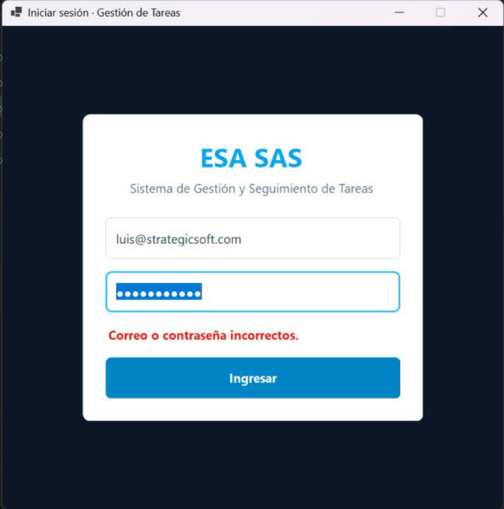 |
| Inicio: indicadores y paneles del dashboard (igual que la web) | 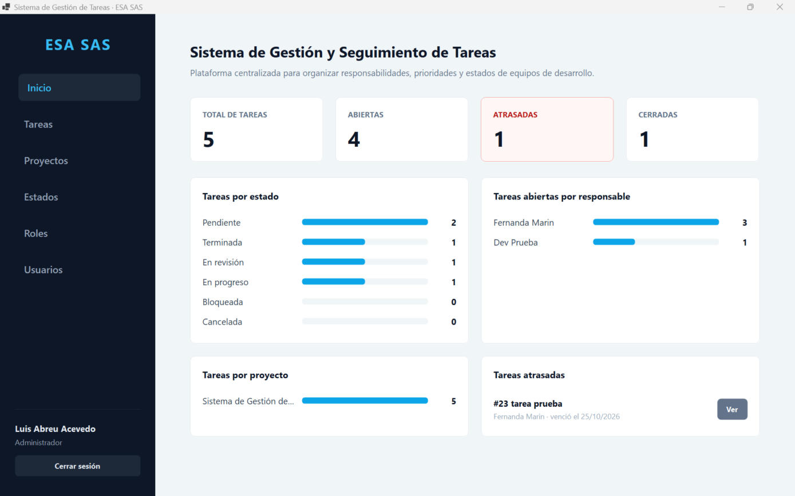 |
| Tareas: formulario de creación (Administrador) | 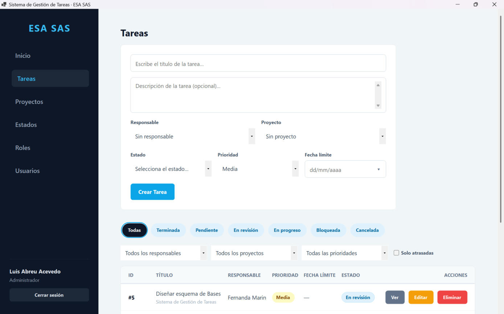 |
| Tareas: data grid con prioridades, estados y la tarea #23 atrasada en rojo | 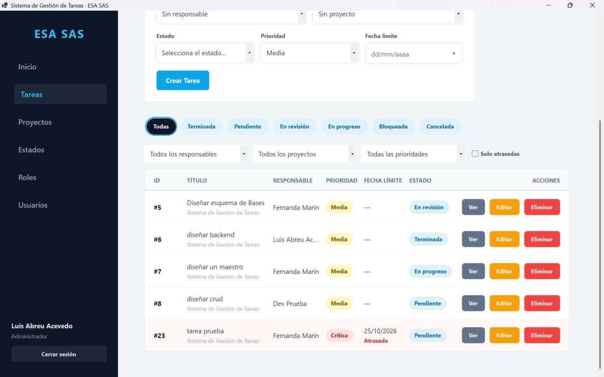 |
| Detalle de una tarea atrasada, con cambio de estado, Editar y Eliminar | 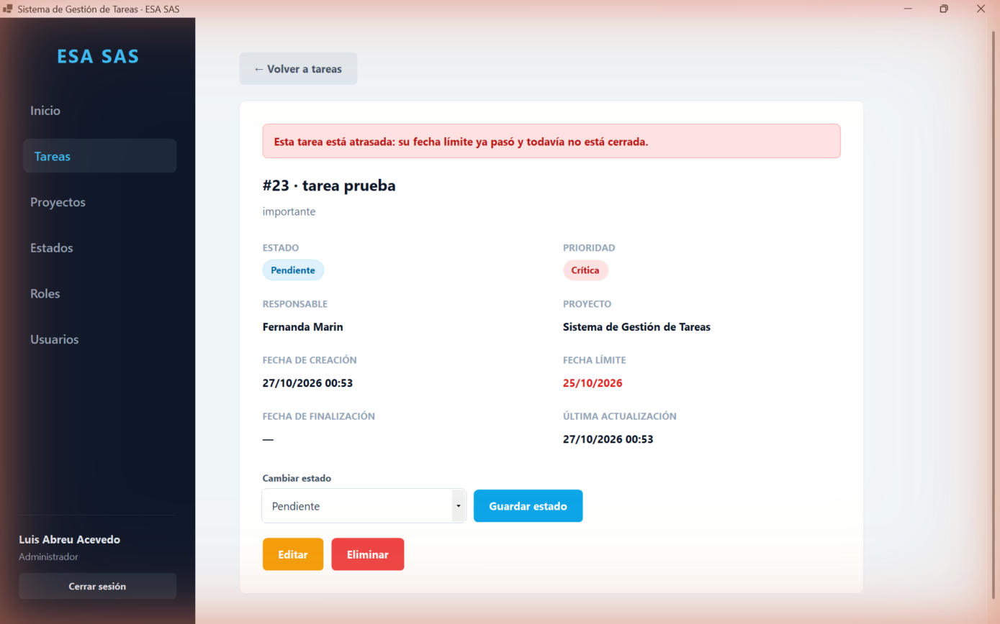 |
| Maestro de Estados (etiqueta "Cierra la tarea") | 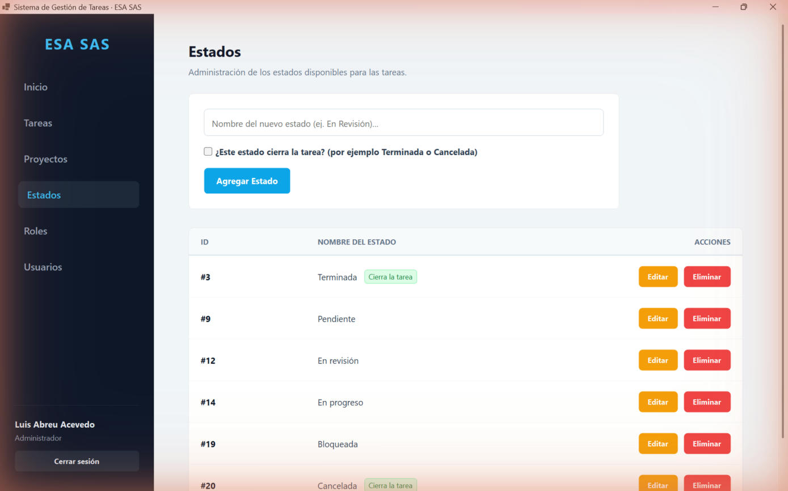 |
| Maestro de Roles (etiquetas de permisos) | 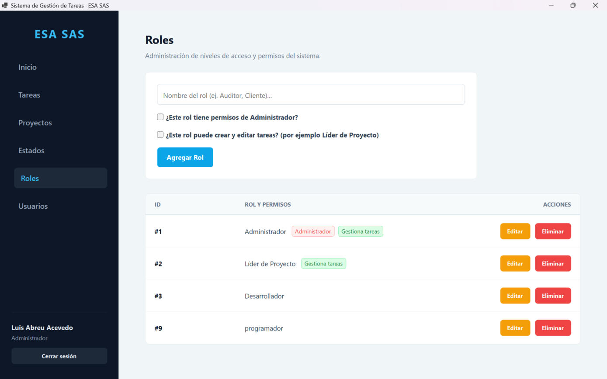 |
| Gestión de Usuarios por rol | 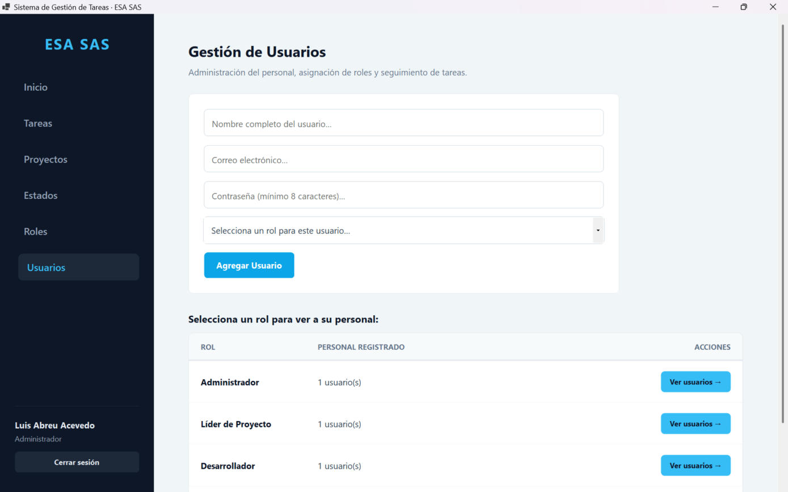 |
| Usuarios del rol Desarrollador, con sus tareas asignadas | 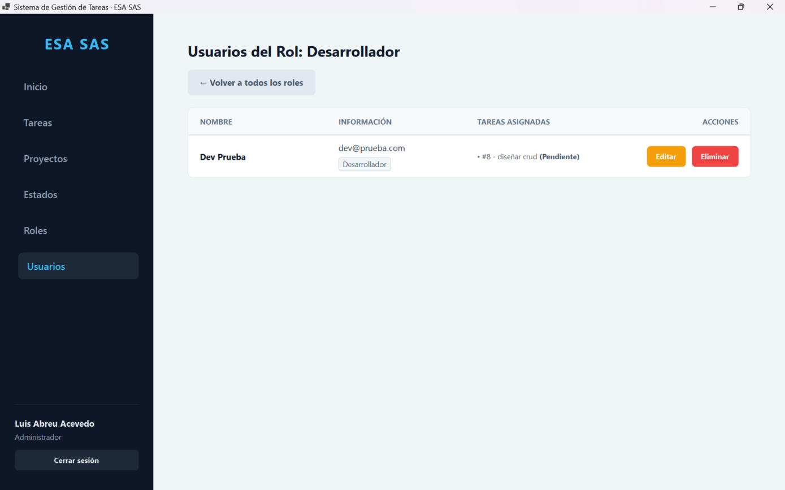 |
| Proyectos, con tareas abiertas y totales | 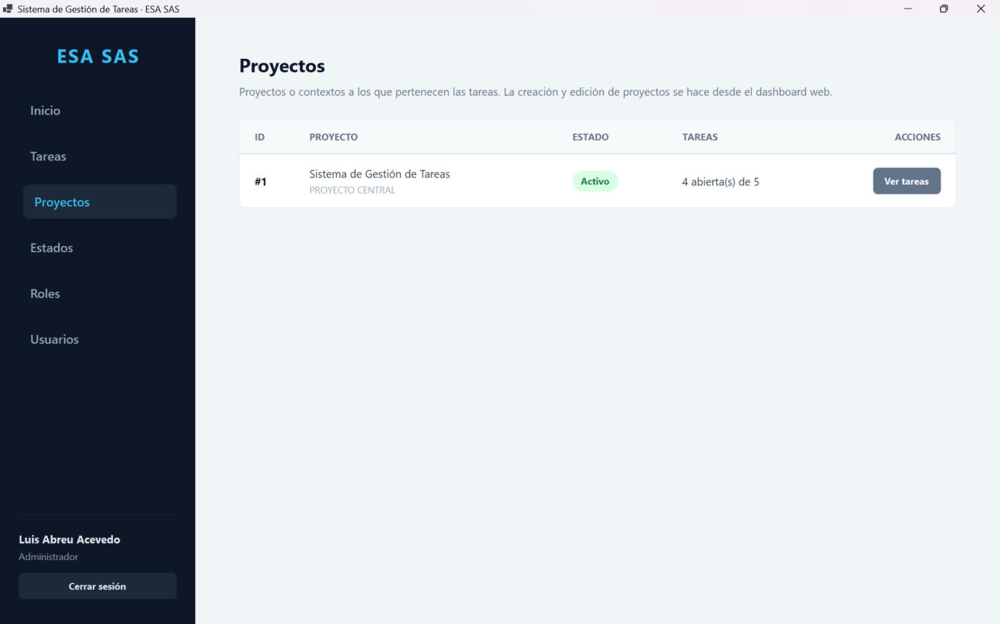 |
| Desarrollador: sin formulario, solo el botón Ver, y menú sin Estados, Roles ni Usuarios | 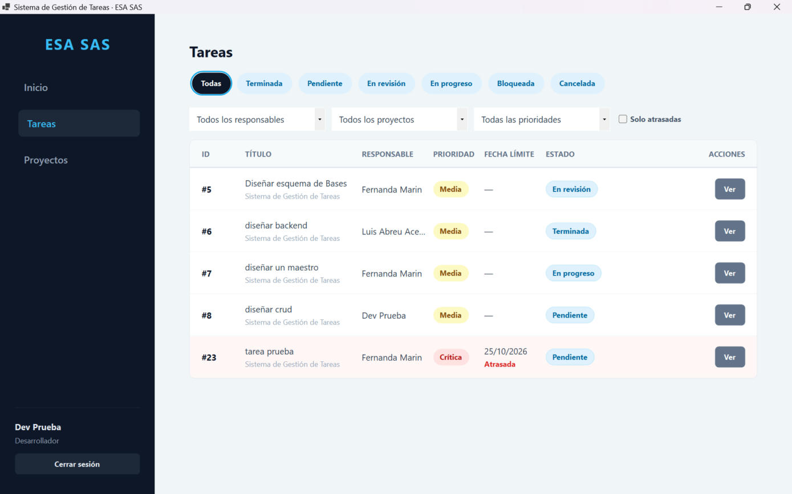 |
| Desarrollador en su propia tarea (#8): puede cambiar el estado, pero no editar ni eliminar | 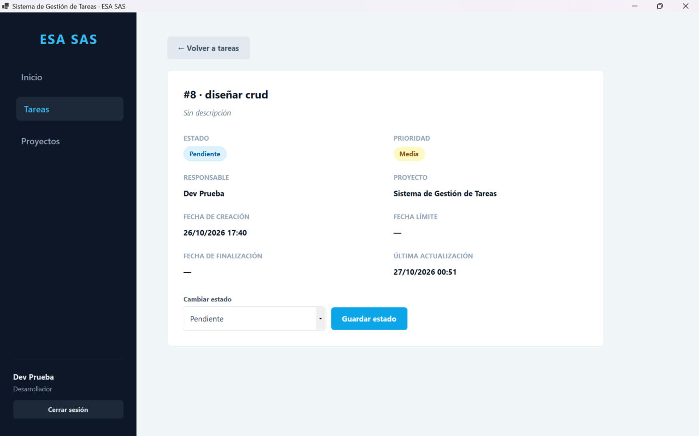 |
| La tarea creada desde el escritorio, vista en el dashboard web | 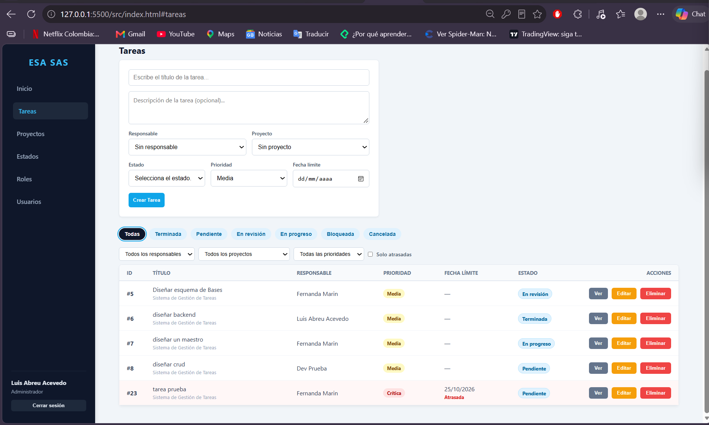 |

### Aplicación móvil con inicio de sesión

| Prueba | Captura |
| --- | --- |
| Contraseña incorrecta | 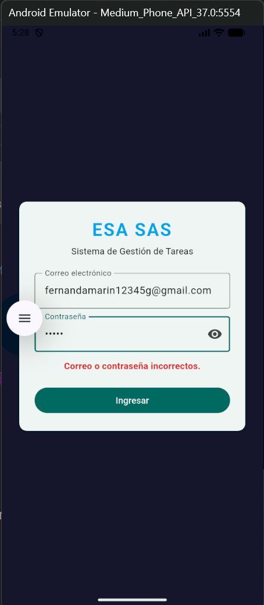 |
| Desarrollador: menú con nombre, rol y "Cerrar sesión", sin "Nueva tarea" | 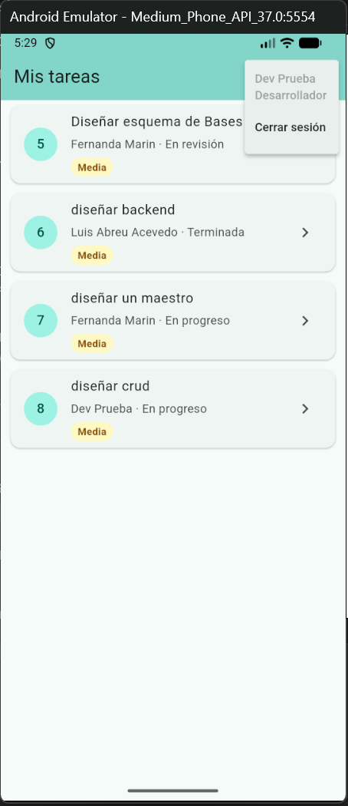 |
| Su propia tarea: "Cambiar estado" disponible | 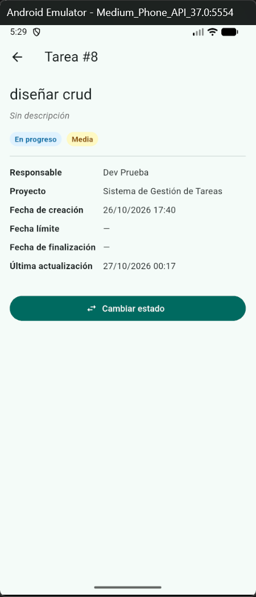 |
| Tarea ajena: sin "Cambiar estado" | 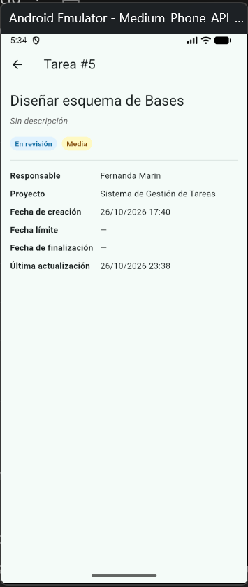 |
| Administrador: aparece "Nueva tarea" | 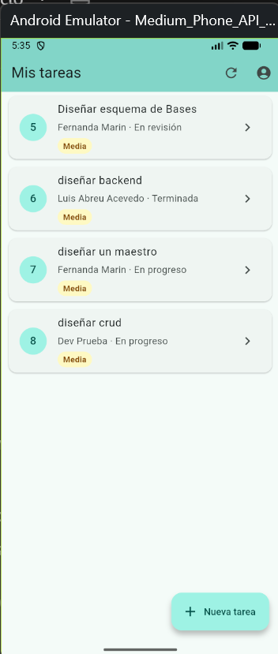 |

Resultados:
- `dotnet build` (escritorio): *Compilación correcta*, 0 errores y 0 advertencias.
- `flutter analyze`: *No issues found*.
- `flutter test`: *All tests passed* (4 pruebas).
- Pruebas de la API en `Backend.http`: 44 casos, incluidos los de inicio de sesión y permisos.

## ¿Qué conceptos aún no domino?

Todavía me falta entender bien cómo se distribuye una aplicación de escritorio a otros usuarios (instaladores, publicar un `.exe` independiente) y cómo se actualiza cuando ya está instalada. También quiero aprender a renovar el token sin pedir la contraseña otra vez (*refresh token*) y a guardar la sesión de forma cifrada en el escritorio y en el móvil. El siguiente paso del proyecto es Docker: entender la diferencia entre imagen y contenedor, y cómo cambiar la dirección de la API cuando el backend ya no corra en `localhost`.
