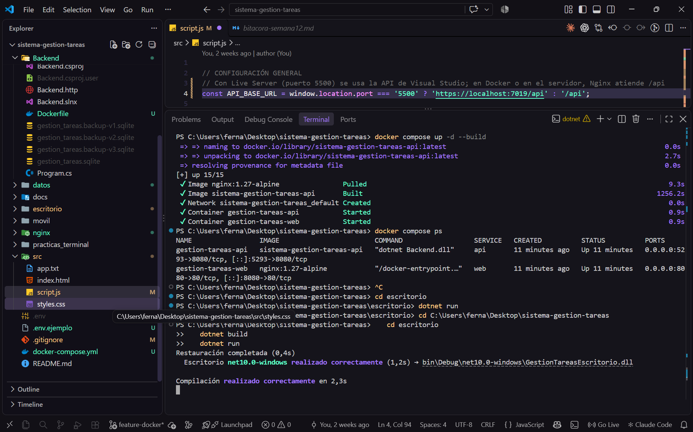
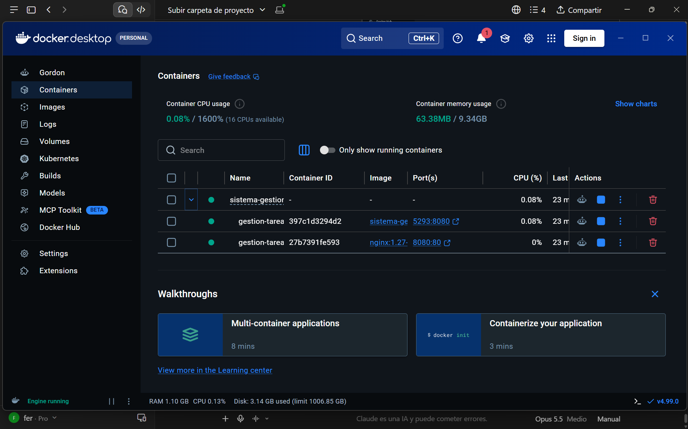
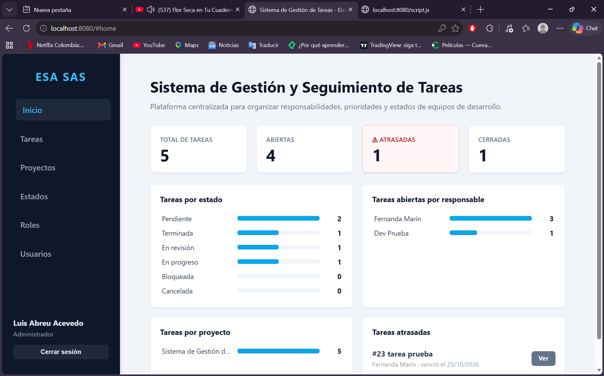
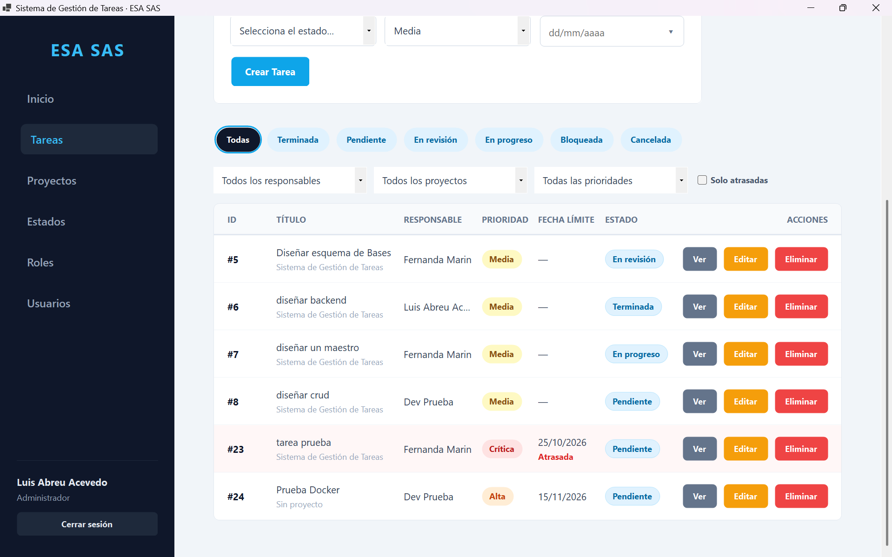

# Bitácora Semana 13

**Tema:** Docker
**Entregable:** API y dashboard web corriendo en contenedores con `docker compose`, conectados a la misma base de datos que usan la app de escritorio y la móvil

## ¿Qué aprendí?

- **Qué es Docker:** es una herramienta que empaqueta una aplicación con todo lo que necesita para funcionar (el runtime de .NET, las librerías, la configuración) y la ejecuta aislada del resto del computador. Así la API corre igual en mi portátil, en el de otra persona o en un servidor, sin instalar .NET en cada uno.
- **Imagen y contenedor:** la **imagen** es la "receta" ya preparada y de solo lectura (por ejemplo `sistema-gestion-tareas-api` o `nginx:1.27-alpine`). El **contenedor** es una copia de esa imagen en ejecución (`gestion-tareas-api` y `gestion-tareas-web`). De una misma imagen se pueden levantar varios contenedores, y si un contenedor se borra, la imagen sigue ahí para crearlo de nuevo.
- **Dockerfile en dos etapas:** el `Backend/Dockerfile` primero compila la API con la imagen del SDK de .NET 10 (`dotnet restore` y `dotnet publish -c Release`) y luego copia solo el resultado a la imagen `aspnet:10.0`, que trae únicamente lo necesario para ejecutar. La imagen final queda mucho más liviana porque no lleva el compilador.
- **Caché de capas:** el `.csproj` se copia antes que el resto del código. Si cambio un controlador pero no los paquetes, Docker reutiliza la capa del `dotnet restore` y no vuelve a descargar las dependencias.
- **`.dockerignore`:** evita que se copien a la imagen carpetas como `bin/`, `obj/` y las bases `.sqlite` locales, para que la imagen sea más pequeña y no lleve datos de prueba.
- **Puertos:** dentro del contenedor la API escucha en el `8080`, pero desde el computador se entra por el `5293` (`"5293:8080"`, puerto del computador : puerto del contenedor). Se eligió el 5293 porque es el mismo que ya usaban la app de escritorio y la móvil, así que no hubo que cambiarles nada. La web queda en `"8080:80"`.
- **Variables de entorno:** la configuración de producción no va escrita en el código. La cadena de conexión (`ConnectionStrings__DefaultConnection`) y la clave para firmar los tokens (`Jwt__Clave`) se pasan como variables de entorno; el doble guion bajo `__` equivale a la sección `ConnectionStrings:DefaultConnection` del `appsettings.json`. La clave JWT se guarda en un archivo `.env` que no se sube a Git; en el repositorio solo queda `.env.ejemplo`.
- **Volúmenes:** un contenedor puede borrarse y recrearse en cualquier momento, y todo lo que haya escrito adentro se pierde. Por eso la base SQLite vive en la carpeta `./datos` del proyecto, montada como volumen en `/app/datos`. Las tareas creadas siguen ahí aunque se reconstruya la imagen.
- **Docker Compose:** en lugar de levantar cada contenedor con un comando largo, `docker-compose.yml` describe los dos servicios (`api` y `web`), sus puertos, variables y volúmenes. Con `docker compose up -d --build` se construye y levanta todo, con `docker compose ps` se ve el estado y con `docker compose down` se detiene.
- **Nginx como servidor web y proxy:** el servicio `web` usa la imagen oficial de Nginx para entregar `index.html`, `styles.css` y `script.js`. Todo lo que empieza por `/api/` lo reenvía al contenedor de la API por la red interna de Compose (`http://api:8080/api/`). Dentro de esa red los contenedores se encuentran por el nombre del servicio, no por `localhost`.
- **Dirección de la API en la web:** `script.js` ahora usa `https://localhost:7019/api` solo cuando la página se abre con Live Server (puerto 5500), para seguir desarrollando con Visual Studio; en Docker o en un servidor usa la ruta relativa `/api`, que atiende Nginx. Así el mismo archivo sirve en los dos casos.

## Arquitectura con Docker

```
Navegador ──► localhost:8080 ──► [ gestion-tareas-web (Nginx) ]
                                      │  /api/...
                                      ▼
Escritorio / móvil ──► localhost:5293 ──► [ gestion-tareas-api (ASP.NET Core) ]
                                                   │
                                                   ▼
                                       ./datos/gestion_tareas.sqlite (volumen)
```

Los tres clientes siguen usando una sola API y una sola base de datos. Lo único que cambió es dónde se ejecuta el backend: antes en Visual Studio y ahora en un contenedor.

## Archivos creados o modificados

| Archivo | Para qué sirve |
| --- | --- |
| `Backend/Dockerfile` | Construye la imagen de la API en dos etapas (compilar y ejecutar) |
| `Backend/.dockerignore` | Excluye `bin/`, `obj/` y las bases locales de la imagen |
| `docker-compose.yml` | Define los servicios `api` y `web`, sus puertos, variables y volúmenes |
| `nginx/default.conf` | Entrega la web y reenvía `/api/` al contenedor de la API |
| `.env.ejemplo` | Muestra qué variables hay que definir (`JWT_CLAVE`) sin exponer la clave real |
| `datos/LEEME.txt` | Explica que ahí vive la base de datos del contenedor |
| `.gitignore` | Ignora `.env` y `datos/*.sqlite` |
| `src/script.js` | Elige la dirección de la API según el puerto (Live Server o Docker) |
| `escritorio/FormPrincipal.cs` | Vuelve a cargar los datos al cambiar de sección en el menú |

## ¿Qué problemas encontré?

- **Docker Desktop no se instalaba desde Microsoft Store:** la tienda mostraba el error `0x00000001` y no avanzaba.
- **Docker necesita WSL 2:** en Windows, Docker Desktop corre los contenedores de Linux sobre el Subsistema de Windows para Linux, y había que tenerlo instalado y actualizado.
- **La primera construcción de la imagen tardó mucho:** cerca de 20 minutos, porque había que descargar las imágenes del SDK y del runtime de .NET 10 y todos los paquetes NuGet.
- **La web en Docker decía "No se pudo conectar con el servidor":** `script.js` todavía apuntaba a `https://localhost:7019/api`, que es la dirección de Visual Studio, y además el navegador seguía usando la versión anterior del archivo guardada en caché.
- **La app de escritorio no mostraba una tarea creada desde la web:** la tarea #24 "Prueba Docker" se creó desde el dashboard en `localhost:8080` y aparecía en la web, pero no en el escritorio, aunque los dos estaban conectados al mismo contenedor.

## ¿Cómo los resolví?

- Se descargó el instalador oficial desde la página de Docker y se instaló con la opción de usar WSL 2.
- Se verificó WSL con `wsl --status` y `wsl --update` antes de abrir Docker Desktop, y se comprobó la instalación con `docker --version` y `docker compose version`.
- La demora de la primera construcción es normal; las siguientes son mucho más rápidas porque Docker reutiliza las capas ya descargadas (caché).
- Se cambió `script.js` para que use `/api` cuando no está en Live Server, y se recargó la página con `Ctrl + Shift + R` para que el navegador descargara la versión nueva.
- El escritorio solo pedía los datos al iniciar sesión y después de sus propias acciones, así que no se enteraba de lo que se cambiaba desde la web o el móvil. Ahora, cada vez que se hace clic en una sección del menú lateral, vuelve a consultar la API. Después del cambio, la #24 apareció al entrar en Tareas.

## Evidencias

| Prueba | Captura |
| --- | --- |
| `docker compose up -d --build`: imágenes construidas y los dos contenedores iniciados; `docker compose ps` con los puertos 5293 y 8080 |  |
| Docker Desktop: los contenedores `gestion-tareas-api` (5293:8080) y `gestion-tareas-web` (8080:80) en ejecución |  |
| Dashboard web servido por Nginx en `localhost:8080`, con datos de la API en Docker |  |
| App de escritorio conectada al contenedor, mostrando la tarea #24 "Prueba Docker" creada desde la web |  |

Resultados:
- `docker compose ps`: los dos contenedores en estado *Up*.
- `dotnet build` (escritorio): *Compilación realizado correctamente*.
- Una tarea creada desde la web en Docker aparece en la app de escritorio, porque las dos leen de la misma API y del mismo volumen de datos.

## ¿Qué conceptos aún no domino?

Todavía me falta entender bien las redes de Docker más allá de la red que crea Compose, y cómo se manejan los registros (logs) cuando la aplicación lleva mucho tiempo corriendo. Tampoco he publicado una imagen en un registro como Docker Hub. El siguiente paso es el despliegue en un servidor (VPS): subir el proyecto, levantarlo con el mismo `docker compose` y configurar HTTPS con un dominio, para que la web y las apps se puedan usar fuera de mi computador.
